<h1 align="center">9Drive</h1>

<p align="center">
  <b>All your free cloud storage, in one drive.</b><br />
  Connect several Google Drive accounts and S3 buckets, then use them as one self-hosted file manager.
</p>

<p align="center">
  <a href="LICENSE"></a>
  
  
  
  <a href="https://9drive.zenhosta.com"></a>
</p>

<p align="center">
  <a href="docs/media/9drive-trailer.mp4">
    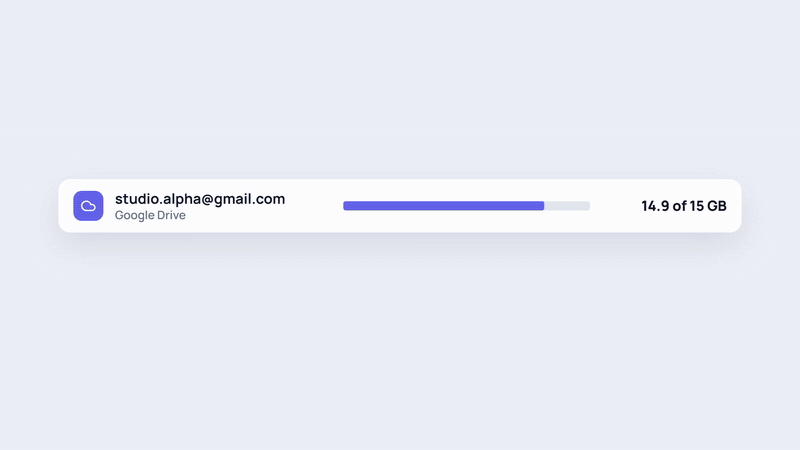
  </a>
  <br />
  <sub>▶ 32-second trailer. Click it to open the full-quality MP4 (<code>docs/media/9drive-trailer.mp4</code>).</sub>
</p>

---

## Why 9Drive?

Every Google account comes with 15 GB of free storage. If you have a few accounts, you have plenty of space, but it's split up, and one account always fills up first.

9Drive joins them together. Connect your Google Drive accounts (and any S3-compatible bucket), and you get:

- 📦 **One storage pool.** See the combined quota of every connected account on one dashboard.
- 🧭 **Uploads that pick the right account.** Each file goes to an account that has enough room. You choose the rule: most free space, round-robin, or your own priority order.
- 🗂️ **A normal file manager.** Folders, search, list and grid views, previews, rename, move, and bulk actions.
- 🔗 **Sharing that works.** Public links with a built-in viewer, embeds, and invites for files and folders.
- 🔌 **An upload API.** Send files from scripts or CI with an API key.
- 🏠 **Your own server.** Files stream straight through your backend to your storage. Nothing is written to the server's disk.

Try the live preview at **[9drive.zenhosta.com](https://9drive.zenhosta.com)**.

## Screenshots

> The screenshots and trailer use made-up demo accounts and files.

<table>
  <tr>
    <td width="50%">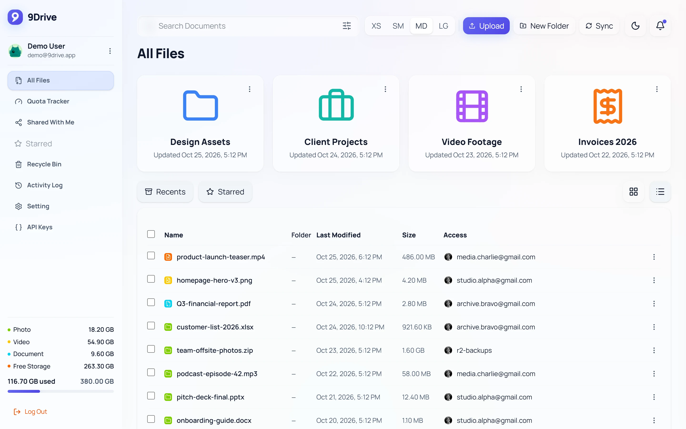<br /><sub><b>All Files</b>: folders with custom icons and colours, plus every file across your accounts.</sub></td>
    <td width="50%">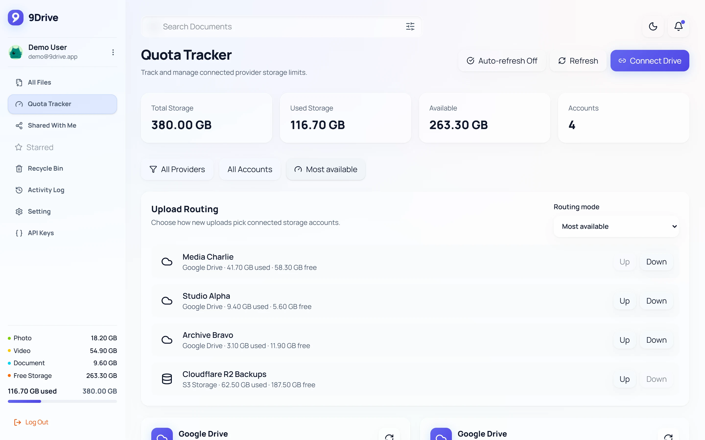<br /><sub><b>Quota Tracker</b>: combined storage and the upload routing order.</sub></td>
  </tr>
  <tr>
    <td>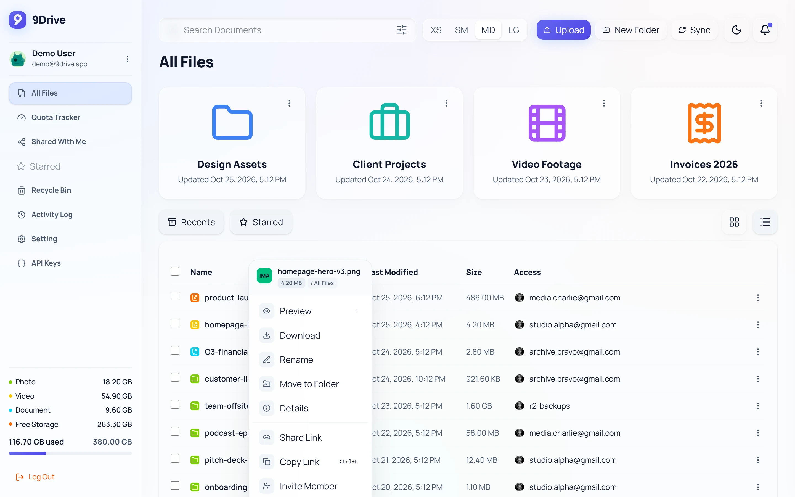<br /><sub><b>Right-click menu</b>: preview, download, rename, move, share, invite.</sub></td>
    <td>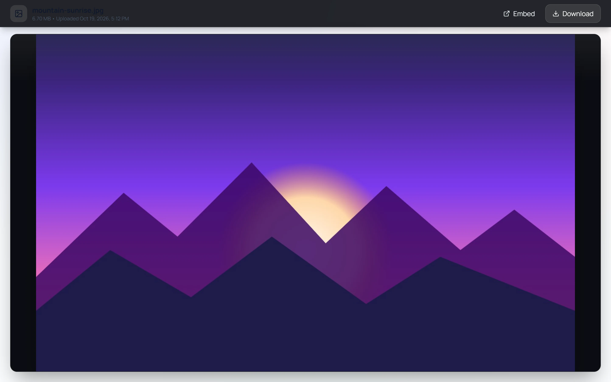<br /><sub><b>Public link</b>: anyone with the link can view or download the file.</sub></td>
  </tr>
  <tr>
    <td>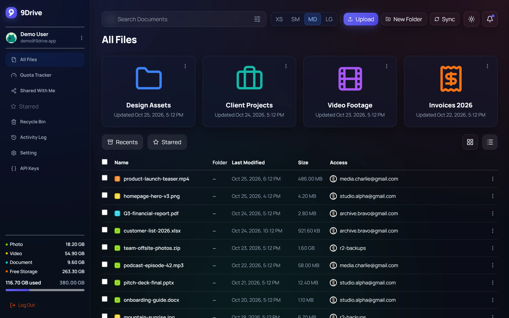<br /><sub><b>Dark mode</b>, one click from the header.</sub></td>
    <td>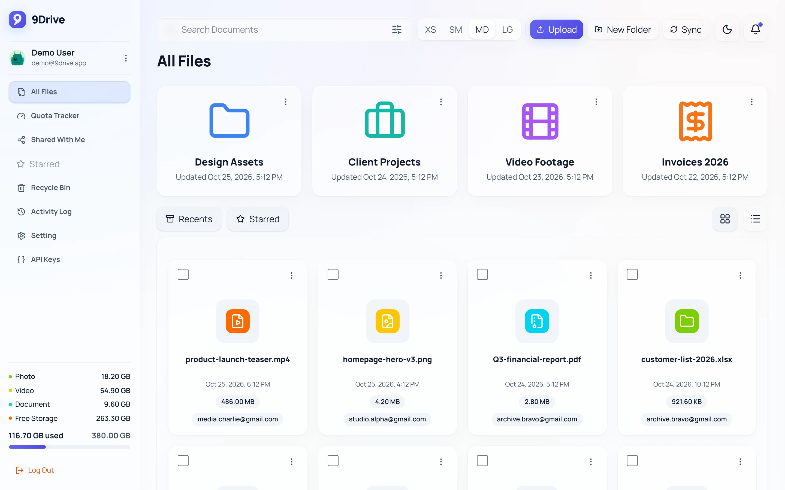<br /><sub><b>Grid view</b> for browsing visually.</sub></td>
  </tr>
  <tr>
    <td>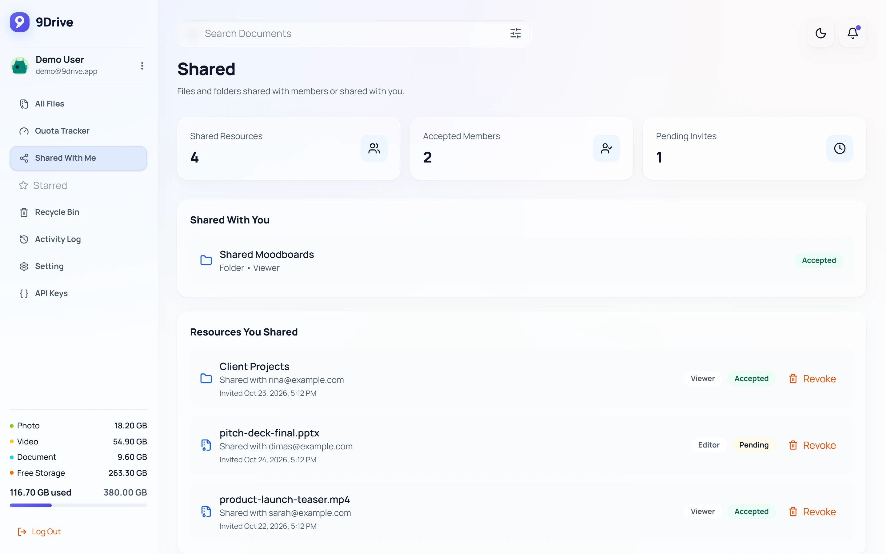<br /><sub><b>Shared</b>: what you shared, who accepted, and what was shared with you.</sub></td>
    <td>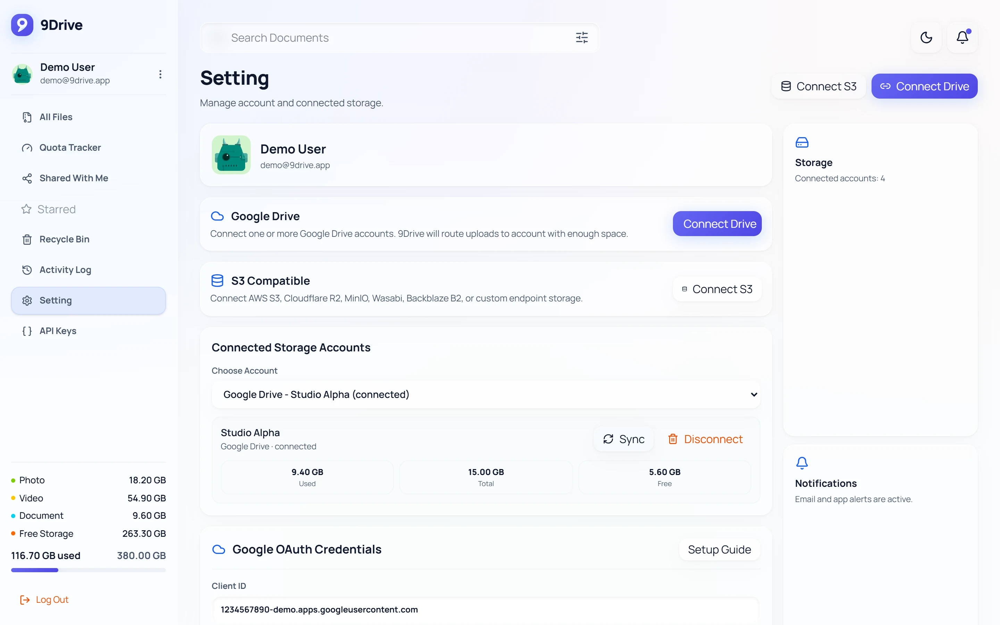<br /><sub><b>Settings</b>: connect Google Drive or S3 and manage the Google OAuth credentials.</sub></td>
  </tr>
  <tr>
    <td>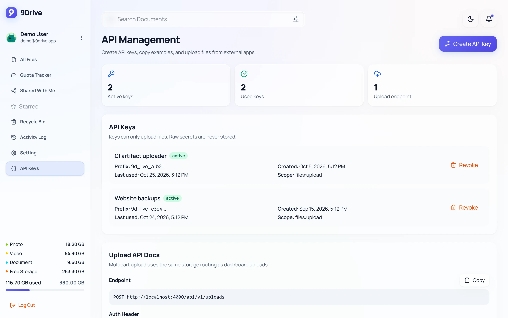<br /><sub><b>API Keys</b>: create keys and copy ready-made upload examples.</sub></td>
    <td>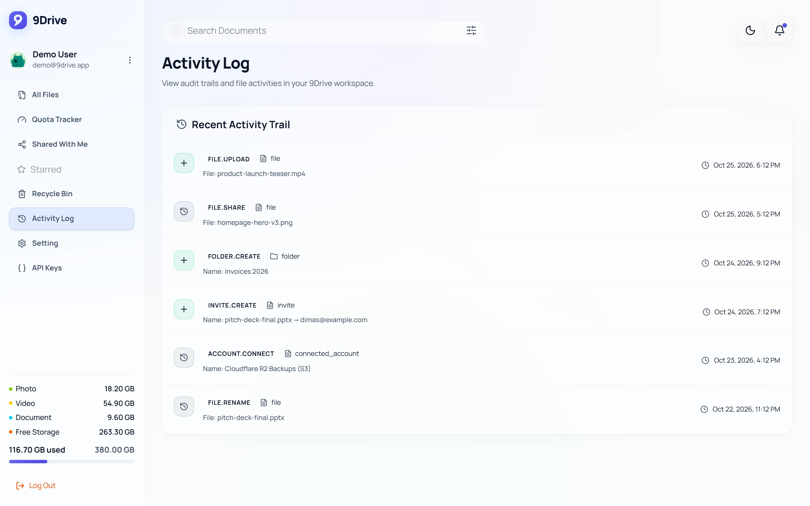<br /><sub><b>Activity Log</b>: a trail of uploads, shares, and changes.</sub></td>
  </tr>
</table>

<p align="center">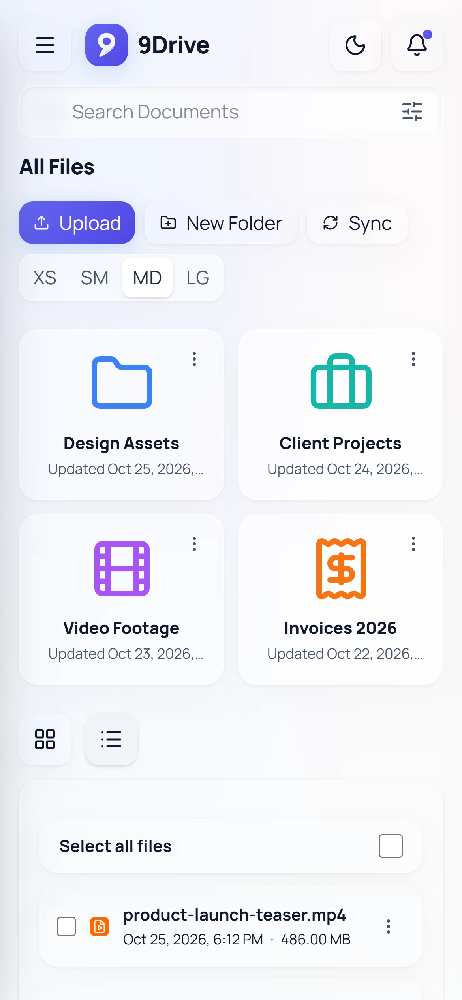<br /><sub>It works on phones too, and can be installed as a PWA.</sub></p>

## Features

**Storage**
- Google Drive and S3-compatible storage in one dashboard. S3 works with AWS S3, Cloudflare R2, MinIO, Wasabi, Backblaze B2, or any custom endpoint.
- Combined quota summary plus a per-account Quota Tracker.
- Upload routing policies: *most available*, *round-robin*, or *priority order*.
- Google Drive uploads land in a root folder called `9drive`. A manual **Sync Drive** button brings changes you made in Google Drive back into 9Drive.

**Files**
- Upload by streaming, with a progress panel in the bottom-right corner.
- Virtual folders, which you can nest, colour, and give icons.
- Header search with filters for type, account, size, and date.
- Preview images, videos, PDFs, and Office files. Download, rename, move, delete, recycle bin.

**Sharing and teamwork**
- Public share links with a viewer and an embed mode.
- Invite people to a file or folder as a viewer or editor.
- Activity log.

**For developers**
- An external upload API at `POST /api/v1/uploads` with API keys. Keys are shown once, stored hashed, track when they were last used, and can be revoked.
- In-app API docs with cURL and JavaScript examples.

**Accounts and admin**
- Email/password sign-up (optional reCAPTCHA) or **Continue with Google**, which connects your first Drive automatically.
- Google OAuth credentials can be set in **Settings**. No `.env` editing needed.
- Backup/restore and one-click updates from Settings (for PM2 setups).

## Quick start

Pick the option that suits you. Docker is the easiest.

### Option A: Docker (recommended)

You only need Docker. MySQL is included.

```bash
git clone https://github.com/zenhosta/9drive.git
cd 9drive
cp .env.docker.example .env      # Windows PowerShell: Copy-Item .env.docker.example .env
# open .env and set JWT_ACCESS_SECRET and TOKEN_ENCRYPTION_KEY to long random strings
docker compose up -d --build
```

Then open **http://localhost:5173** and create an account. 🎉

What happens behind the scenes:
- The backend runs the database migrations on every start, so updating an existing install keeps your data.
- If `GOOGLE_CLIENT_ID` and `GOOGLE_CLIENT_SECRET` in `.env` are real values, the Google config is saved automatically. If they are blank, the app still starts and you can add them later in **Settings → Google Credentials**.

| Service  | URL                     |
| -------- | ----------------------- |
| Frontend | http://localhost:5173   |
| Backend  | http://localhost:4000   |
| MySQL    | localhost:3306          |

<details>
<summary><b>Useful Docker commands</b></summary>

```bash
docker compose logs -f backend      # backend logs (also: frontend, mysql)
docker compose exec backend npm run seed:google-config   # re-save Google OAuth config from .env
docker compose down                 # stop
docker compose down -v              # stop and delete the database volume
```

</details>

### Option B: Run locally (for development)

You need **Node.js 20+**, **npm**, and **MySQL 8+** running on your machine.

**1. Run the setup script.** It writes `backend/.env` and `frontend/.env` with secure random keys, installs dependencies, and generates the Prisma client.

```bash
# Linux / macOS
bash ./setup.sh
```

```powershell
# Windows (PowerShell, from the project folder)
powershell -ExecutionPolicy Bypass -File .\setup.ps1
```

Enter your MySQL URL when asked (default `mysql://root@localhost:3306/9drive`). You can leave the Google credentials empty for now.

**2. Create the tables and start both apps** in two terminals:

```bash
cd backend
npm run prisma:migrate
npm run dev          # http://localhost:4000
```

```bash
cd frontend
npm run dev          # http://localhost:5173
```

<details>
<summary><b>Prefer to set things up by hand?</b></summary>

```bash
cd backend && npm install
cd ../frontend && npm install
mysql -u root -e "CREATE DATABASE IF NOT EXISTS 9drive;"
```

Create `backend/.env`:

```env
DATABASE_URL="mysql://root@localhost:3306/9drive"
APP_PORT=4000
FRONTEND_URL="http://localhost:5173"
JWT_ACCESS_SECRET="change-this-jwt-secret-at-least-32-chars"
TOKEN_ENCRYPTION_KEY="change-this-encryption-key-32bytes!"
ACCESS_TOKEN_TTL_SECONDS=900
REFRESH_TOKEN_TTL_DAYS=30
MAX_UPLOAD_BYTES=5368709120
RECAPTCHA_SECRET_KEY=""

# Only read by `npm run seed:google-config`, which stores them encrypted in the database.
GOOGLE_CLIENT_ID=""
GOOGLE_CLIENT_SECRET=""
GOOGLE_REDIRECT_URI="http://localhost:4000/connected-accounts/google/callback"
```

Create `frontend/.env`:

```env
VITE_API_URL=http://localhost:4000
VITE_RECAPTCHA_SITE_KEY=
```

Then run `npm run prisma:migrate` in `backend/` and start both dev servers as shown above.

</details>

### Your first five minutes

1. Open http://localhost:5173 and **register**, or use **Continue with Google** (this connects your first Drive automatically).
2. Go to **Settings → Connect Drive** to add more Google accounts, or **Connect S3** to add a bucket.
3. Open **Quota Tracker** to see your combined storage and choose an upload routing mode.
4. Go to **All Files**, create a folder, and upload something. Watch the progress panel in the corner.
5. Right-click the file and choose **Share Link**, then open the link in a private window.

## Connecting Google Drive

Google sign-in and Drive access need a free OAuth client from **Google Cloud Console** (not Google Search Console). It takes about 10 minutes, once.

<details>
<summary><b>Step-by-step Google Cloud setup</b></summary>

1. **Create or pick a project** at https://console.cloud.google.com/. The OAuth client and the Drive API must be in the same project.
2. **Enable the Google Drive API**: *APIs & Services → Library → Google Drive API → Enable*. It can take a few minutes to take effect.
3. **Configure the OAuth consent screen**: *APIs & Services → OAuth consent screen*.
   - User type: **External**. Fill in the app name, support email, and developer contact email.
   - Add these scopes:
     ```txt
     https://www.googleapis.com/auth/drive
     https://www.googleapis.com/auth/userinfo.email
     https://www.googleapis.com/auth/userinfo.profile
     ```
     Full Drive access is needed so that Google sign-in can connect the first Drive and so that files you add to the `9drive` folder by hand can be synced.
   - While the app is in **Testing**, add every Google account you'll use under **Test users**.
4. **Create the OAuth client**: *APIs & Services → Credentials → Create Credentials → OAuth client ID → Web application*.
   - Authorized JavaScript origin: `http://localhost:5173`
   - Authorized redirect URI: `http://localhost:4000/connected-accounts/google/callback`
   - Copy the **Client ID** and **Client Secret**.
5. **Give the credentials to 9Drive.** Either way works:
   - **In the app (easiest):** log in, open **Settings → Google Credentials**, paste the Client ID, Client Secret, and Redirect URI, then click **Save Configuration**.
   - **From the command line:** put `GOOGLE_CLIENT_ID`, `GOOGLE_CLIENT_SECRET`, and `GOOGLE_REDIRECT_URI` in `backend/.env` and run `cd backend && npm run seed:google-config`. With Docker, use `docker compose exec backend npm run seed:google-config`.

Either way, the credentials are encrypted and stored in MySQL as one global config. Google sign-in uses it too.

</details>

## Configuration

<details>
<summary><b>Backend environment variables</b> (<code>backend/.env</code>)</summary>

| Variable | What it does |
| --- | --- |
| `DATABASE_URL` | MySQL connection string. |
| `APP_PORT` | Backend port (default `4000`). |
| `FRONTEND_URL` | The frontend's URL. CORS only allows this origin. |
| `JWT_ACCESS_SECRET` | Secret for signing access tokens. At least 32 characters, random. |
| `TOKEN_ENCRYPTION_KEY` | Key for encrypting Google tokens and S3 credentials. At least 32 characters, random. |
| `ACCESS_TOKEN_TTL_SECONDS` | Access token lifetime (default `900`). |
| `REFRESH_TOKEN_TTL_DAYS` | Refresh token lifetime (default `30`). |
| `MAX_UPLOAD_BYTES` | Largest allowed upload (default 5 GB). |
| `RECAPTCHA_SECRET_KEY` | Optional. Turns on captcha for sign-up, together with the frontend site key. |
| `GOOGLE_CLIENT_ID` / `GOOGLE_CLIENT_SECRET` / `GOOGLE_REDIRECT_URI` | Only read by the seed command. The app reads the encrypted copy from the database. |

</details>

<details>
<summary><b>Frontend environment variables</b> (<code>frontend/.env</code>)</summary>

| Variable | What it does |
| --- | --- |
| `VITE_API_URL` | Backend URL. Vite bakes it in at build time, so **rebuild the frontend after changing it**. |
| `VITE_RECAPTCHA_SITE_KEY` | Optional reCAPTCHA site key. Leave it empty to turn captcha off. Also baked in at build time. |

Captcha only turns on when **both** `VITE_RECAPTCHA_SITE_KEY` and `RECAPTCHA_SECRET_KEY` are set.

</details>

## Deploying to a server

<details>
<summary><b>VPS with Docker, step by step</b></summary>

1. **Install Docker** (Ubuntu/Debian):
   ```bash
   sudo apt update
   sudo apt install -y docker.io docker-compose
   sudo systemctl enable --now docker
   ```
2. **Clone and configure:**
   ```bash
   git clone https://github.com/zenhosta/9drive.git
   cd 9drive
   cp .env.docker.example .env
   nano .env
   ```
   - `FRONTEND_URL`: your public frontend URL, e.g. `https://9drive.yourdomain.com`
   - `VITE_API_URL`: your public backend URL, e.g. `https://api.9drive.yourdomain.com`
   - `GOOGLE_REDIRECT_URI`: e.g. `https://api.9drive.yourdomain.com/connected-accounts/google/callback`
   - Strong random values for `JWT_ACCESS_SECRET` and `TOKEN_ENCRYPTION_KEY`
   - Your `GOOGLE_CLIENT_ID` and `GOOGLE_CLIENT_SECRET`
3. **Start it:** `docker compose up -d --build`
4. **Update Google Cloud Console:** add your frontend URL under *Authorized JavaScript origins* and your redirect URI under *Authorized redirect URIs*.

Production tips:
- Put the frontend and backend behind an HTTPS reverse proxy.
- Don't expose the MySQL port to the internet.
- Rebuild the frontend whenever `VITE_API_URL` or `VITE_RECAPTCHA_SITE_KEY` changes.
- Publish the OAuth consent screen when you're ready. Google may ask to verify public apps.

</details>

<details>
<summary><b>Without Docker</b></summary>

```bash
cd backend
npm run build
npm run start:deploy     # = prisma migrate deploy + start the server
```

```bash
cd frontend
npm run build            # serve frontend/dist with any static web server
```

`prisma migrate deploy` never resets data. If Prisma reports migration drift, stop and repair the migration history first. **Never run `prisma migrate reset` in production.**

</details>

<details>
<summary><b>One-click updates (PM2 setups)</b></summary>

On a VPS where the backend runs under PM2, **Settings** has an update button and a live log viewer. When you press it, the backend runs `update.sh` from the project root. If that file doesn't exist, it falls back to `git pull`.

A typical `update.sh` does the same as these manual commands:

```bash
git reset --hard
git pull origin main
cd backend && npm install && npx prisma generate && npm run build && npx prisma migrate deploy
cd ../frontend && npm install && npm run build
pm2 restart 9drive-backend
```

</details>

## Upload API

Create a key under **API Keys** in the app, then send files as `multipart/form-data`. Each upload is routed using the same rules as the dashboard.

```bash
curl -X POST "http://localhost:4000/api/v1/uploads" \
  -H "Authorization: Bearer 9d_live_xxx" \
  -F 'filesMeta=[{"fieldName":"file-0","fileName":"hello.txt","mimeType":"text/plain","sizeBytes":"12"}]' \
  -F "file-0=@hello.txt;type=text/plain"
```

`filesMeta` must come **before** the files. It's a JSON array of `{ fieldName, fileName, mimeType, sizeBytes, folderId? }`, and each `fieldName` matches a file field (`file-0`, `file-1`, …).

<details>
<summary><b>Full REST API overview</b></summary>

Authenticated routes expect `Authorization: Bearer <accessToken>`.

```txt
Health        GET  /health

Auth          POST /auth/register · POST /auth/login · POST /auth/refresh · POST /auth/logout · GET /auth/me
              GET  /auth/google/url · GET /auth/google/callback · POST /auth/google/exchange

Accounts      GET  /connected-accounts · DELETE /connected-accounts/:id · POST /connected-accounts/:id/sync-quota
              GET  /connected-accounts/google/connect-url · GET /connected-accounts/google/callback
              POST /connected-accounts/s3

Storage       GET  /storage/summary · GET /storage/breakdown
              GET  /storage/routing-policy · PATCH /storage/routing-policy

Folders       GET  /folders?parentId=<id> · GET /folders?all=1 · GET /folders/recent?limit=4
              POST /folders · PATCH /folders/:id · DELETE /folders/:id

Files         GET  /files · /files?folderId=<id> · /files?q=<search> · GET /files/:id · GET /files/trash
              PATCH /files/:id · PATCH /files/batch · DELETE /files/:id · DELETE /files/batch
              POST /files/batch/restore · DELETE /files/batch/permanent · POST /files/batch-download
              POST /files/sync-google · GET /files/shared-links
              POST /files/:id/share · DELETE /files/:id/share · POST /files/:id/public-permission
              POST /files/:id/preview-token · GET /files/:id/view-url · GET /files/:id/download
              GET  /files/preview/:token

Uploads       POST /uploads
              POST /uploads/resumable/init · PUT /uploads/resumable/chunk/:id · GET /uploads/resumable/status/:id

Invites       GET /invites · POST /invites · DELETE /invites/:id
API keys      GET /api-keys · POST /api-keys · DELETE /api-keys/:id
Activity      GET /audit-logs
Public files  GET /public/files/:token · GET /public/files/:token/download · GET /public/files/:token/preview
External API  POST /api/v1/uploads   (API key with the files:upload scope)
```

</details>

## Troubleshooting

<details>
<summary><b>"Google Drive API has not been used in project … or it is disabled"</b></summary>

Enable the Google Drive API in the **same** Cloud project as your OAuth client (*APIs & Services → Library*), then wait a few minutes.

</details>

<details>
<summary><b>"Access blocked … Error 403: access_denied"</b></summary>

Your consent screen is in **Testing** mode. Add the Google account under *OAuth consent screen → Test users*.

</details>

<details>
<summary><b>Prisma client generation fails on Windows</b></summary>

A running Node process is locking the file. Stop the backend and frontend dev servers, then run `npx prisma generate` in `backend/`.

</details>

<details>
<summary><b>The frontend still calls the old API URL</b></summary>

Vite bakes `VITE_API_URL` into the build. Rebuild the frontend, or with Docker run `docker compose up -d --build`.

</details>

## Security

- Uploads stream through the backend straight to Google Drive or S3. **Nothing is stored on the server's disk.**
- Google tokens and S3 credentials are encrypted in MySQL. App refresh tokens, API keys, preview tokens, and auth-handoff tokens are stored only as hashes.
- CORS only allows `FRONTEND_URL`.
- Never commit `.env` files or share `TOKEN_ENCRYPTION_KEY`, `JWT_ACCESS_SECRET`, `RECAPTCHA_SECRET_KEY`, OAuth client secrets, or raw share links you want to keep private.

## Project structure

```txt
backend/    Express 5 + TypeScript API, Prisma (MySQL), Google Drive and S3 integrations
frontend/   React 19 + Vite + Tailwind CSS 4 app (installable PWA)
docs/       README screenshots and trailer
```

Build checks: `cd backend && npm run build` and `cd frontend && npm run build`.

## Star history

[](https://star-history.dera.page/#zenhosta/9drive&type=Date)

## License

Copyright 2026 Zenhosta

Licensed under the Apache License, Version 2.0. See [LICENSE](LICENSE) for details.
